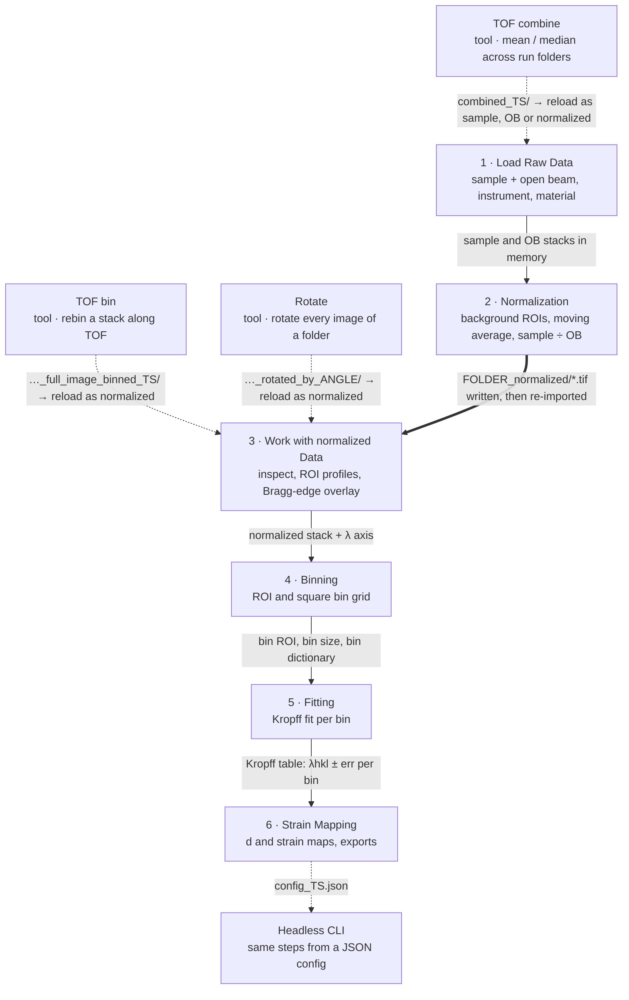

# iBeatles workflow

What the PyQt iBeatles application does, stage by stage: what the user selects,
what is computed, what is written, and how each stage hands off to the next.
Every stage is described in the same shape, so the document can serve as a
functional specification of the current behaviour.

> **Source of this document.** Everything here was read from the code under
> `src/ibeatles` on the `next` branch at commit `e232c9e`. Nothing was
> executed, so behaviour listed under
> [Suspected defects](#suspected-defects-from-reading-the-code) comes from
> reading, not from a reproduction. Anything delegated to the external
> `neutronbraggedge` and `NeuNorm` libraries (time-spectra parsing, TOF to
> wavelength, the material table, the normalization kernels) was not inspected
> and is described from how iBeatles calls it.

| | |
|---|---|
| **Scope** | Sample and open-beam stacks to per-bin Bragg-edge strain maps, plus three TOF pre-processing tools |
| **Shape** | One main window with four step tabs, three tool windows, and three analysis windows opened in order (binning, fitting, strain mapping) |
| **Runtime** | Python 3.12, PyQt5 through qtpy, pyqtgraph and matplotlib. Everything runs on the GUI thread |
| **Headless** | `ibeatles --no-gui <config.json>` runs a fixed pipeline from `core/`, with its own fitting code |
| **Hand-off** | In-memory state on the main window; normalized data is also written to disk and re-imported |
| **Persistence** | Session JSON, auto-saved on close to `~/.ibeatles_session.json` and offered on next start |

Contents: [Pipeline](#pipeline) · [Stages](#stages) ·
[Headless CLI](#headless-cli) · [Files and formats](#files-and-formats) ·
[Formulas and constants](#formulas-and-constants) ·
[Notes for a reimplementation](#notes-for-a-reimplementation)

## Pipeline



Solid arrows are in-memory hand-offs inside the running application; dotted
arrows go through disk.

The edge to notice is the thick one: normalization always writes the result to
a folder first and then loads that folder into tab 3, so stages 3 to 6 can
equally be started from a folder of already-normalized images. Stages 4, 5 and
6 are separate windows, each gated on the one before it.

## Stages

Each block lists purpose, inputs, controls with defaults, processing in
execution order, outputs, and the hand-off to the next stage.

### Shell — main window

- **Layout.** Two outer tabs: **Pre-processing** (three buttons: rotate, TOF
  combine, TOF binning) and **Main**. Main has four inner tabs in order:
  "Load Raw Data" (sub-tabs Sample, Open Beam), "Normalization of the data",
  "Work with normalized Data", "Analysis" (buttons: pixel binning, fitting,
  strain mapping). A panel "Instrument and Material Settings" sits below tabs
  1 and 3.
- **Menus.** Session (Load, Save) · Steps (1. Load Data, 2. Normalization, 3.
  Normalized Data, 4. Binning, 5. Fitting, 6. Strain Mapping; Ctrl+1 to Ctrl+6)
  · Tools (Rotate Normalized Images) · View (show the settings panel) · Log
  (About, Log viewer).
- **Gating.** Normalization needs sample data. Binning needs normalized data.
  Fitting needs normalized data and a bin ROI. Strain mapping needs a fitted
  table. A refused step shows "Unable to start this step!".
- **Session.** On close the whole state is written to
  `~/.ibeatles_session.json`. On start the user is asked whether to reload it
  and, if several parts are restorable, which of "Sample and OB", "Normalized",
  "Bin", "Fitting". Restoring reloads the image files from the stored folder.
- **Log.** `~/.iBeatles.log`, with a viewer window and a line-count limit
  (500).

### Tool · Rotate — Pre-processing tab, or Tools menu

- **Purpose.** Rotate every image of a folder by one angle.
- **Inputs.** A TIFF folder.
- **Controls.** Rotation angle in degrees, −180 to 180 (0). Export option
  "reload rotated data in normalized tab".
- **Processing.** `scipy.ndimage.rotate` per frame with its defaults: the
  output is enlarged to hold the rotated image, cubic interpolation, zero fill.
- **Outputs.** `<out>/<folder>_rotated_by_<angle>/` with the original file
  names and the time-spectra file copied. Negative angles are written
  `minus_<abs>` and the decimal point becomes `_`.
- **Preview.** Mean image rotated live under a 100-pixel grid.
- **Hand-off.** Optional reload into the normalized tab.

### Tool · TOF combine — Pre-processing tab

- **Purpose.** Combine several run folders frame by frame into one stack.
- **Inputs.** A top folder; every subfolder holding TIFFs is listed with a
  "Use it?" checkbox.
- **Controls.** How to combine: mean (default) or median. Visualize (off).
  Reload target after export: none (default), sample, ob, normalized.
- **Processing.** `mean` or `median` over the folders, per frame and pixel.
  File counts and image sizes are not checked for agreement.
- **Outputs.** `<chosen>/combined_<timestamp>/image_NNNN.tiff` (0-based,
  float32) plus the first folder's time-spectra file.
- **Preview.** Integrated image with an ROI and its profile against file
  index, TOF or λ.
- **Hand-off.** Optional reload into the chosen tab.

### Tool · TOF bin — Pre-processing tab

- **Purpose.** Rebin a stack along the TOF axis.
- **Inputs.** A TIFF folder with its `*_Spectra.txt` (asked for if missing) and
  an optional `*_ShutterCount.txt`.
- **Controls.**
  - Auto, log (default): Δtof/tof 0.1, or Δλ/λ 0.1.
  - Auto, linear: Δ file index 20, Δ tof 99.99 µs, or Δλ 10 Å.
  - Manual: bins drawn as draggable regions, or imported from the auto table.
  - Combine within a bin: mean (default) or median.
  - Export: full image and/or ROI; ASCII for full image and/or ROI; include
    experimental errors (on).
- **Processing.** Linear edges step by Δ from the first axis value; log edges
  grow by `e·(1 + r)`. Each frame goes to the bin of the last edge at or below
  its value. The binned image is the mean or median of its member frames.
- **Outputs.**
  - `<base>_full_image_binned_<ts>/` and `<base>_roi_binned_<ts>/`, each with
    `image_NNNN.tiff`, `metadata.json` (file indices, TOF and λ per bin) and
    `image_Spectra.txt`.
  - `<base>_{full_image|roi}_binned_<ts>.txt`, tab-separated: bin index, mean
    TOF (µs), mean λ (Å), mean energy (eV), total counts, optional uncertainty
    from the MCP dead-time model in `core/detector/uncertainty.py`.
- **Preview.** Integrated image with an ROI; ROI profile with the bins drawn as
  coloured regions; statistics table.
- **Hand-off.** Optional reload of the rebinned full image into the normalized
  tab.

### 01 · Load Raw Data — Main tab 1

- **Purpose.** Load the sample and open-beam stacks, set the instrument
  geometry, and pick the material.
- **Inputs.** One folder per stack (folder dialog, no file picking). TIFF or
  FITS, one image per file, sorted by name; the most frequent extension in the
  folder is used. NaN and Inf are set to 0. The time-spectra file is the first
  `*_Spectra.txt` in the sample folder, or chosen by hand.
- **Instrument.** Distance source-detector (25.0 m). Detector offset
  (5000 µs). Beam rate 60 or 30 Hz (disabled). Changing a value recomputes the
  λ axis.
- **Material.**
  - Pre-defined: a list from `neutronbraggedge`, with lattice, crystal
    structure and a table of h, k, l, λ₀.
  - Custom, method 1: name, lattice, FCC or BCC; the table is generated and
    editable.
  - Custom, method 2: name and up to 10 rows of h, k, l, d₀, with λ = 2·d₀.
- **Preview.** Image view (mean or sum of the selected files) with ROIs in four
  colour groups; Bragg-edge profile of the ROIs against file index, TOF (µs)
  or λ (Å). In λ mode the material's edges are drawn as labelled lines, four at
  a time. A region on the profile is linked to the file-list selection.
- **Outputs.** None.
- **Hand-off.** Stacks, λ axis and material stay in memory. Tab 2 unlocks once
  a sample is loaded.

### 02 · Normalization — Main tab 2

- **Purpose.** Turn the sample (and optional open beam) into transmission and
  write it to disk.
- **Inputs.** The sample stack; the open beam if loaded. Without an open beam,
  at least one background ROI is required.
- **Controls.**
  - ROIs Manager table: Use?, Xo, Yo, Width, Height, Type (`sample` or
    `background`); a new row is `0, 0, 20, 20, background`. Only checked
    `background` rows enter the maths; `sample` rows only feed the profile
    plot.
  - Settings dialog: Activate moving average (on). Dimension 2D (default) or
    3D. Size default 3 × 3 × 3 (y, x, λ) or custom. Type Box (default) or
    Gaussian. Order "Moving Average, Normalization" (default) or
    "Normalization, Moving Average".
- **Processing.**
  1. Ask for an output folder.
  2. With the default order, smooth the sample stack (the open beam is not
     smoothed in the GUI). Box is a uniform convolution, Gaussian uses the
     sizes as sigmas; edges are reflected.
  3. Per frame, pool each stack's background ROIs as total counts ÷ total
     pixels. An ROI of width w and height h covers (w+1) × (h+1) pixels.
  4. Same frame count in sample and OB: `T_k = (S_k / roi_S) / (O_k / roi_O)`,
     paired 1:1. Different counts: the ROI-corrected OB is collapsed to its
     per-pixel median first. No OB: `T_k = S_k / roi_S`.
  5. With an OB, non-finite results are set to 0.
- **Outputs.** `<chosen>/<sample folder>_normalized/normalized_image_NNNN.tif`
  (1-based, 4 digits, float32) plus the sample's `*_Spectra.txt`. A timestamp
  is appended to the folder name if it already exists.
- **Preview.** Mean sample image with the ROIs; mean counts per frame for the
  pooled sample and background ROIs.
- **Hand-off.** The written folder is imported into tab 3 and the window
  switches to it.

### 03 · Work with normalized Data — Main tab 3

- **Purpose.** Inspect the transmission stack and check the Bragg edges
  against the material before analysis.
- **Inputs.** The folder just written by stage 2, or any folder of normalized
  images with its time-spectra file.
- **Controls and preview.** Same as stage 1: image view, ROI editor, profile
  against file index, TOF or λ, material edge lines, instrument and material
  panel.
- **Outputs.** None.
- **Hand-off.** Normalized stack, λ axis and material are what stages 4 to 6
  read.

### 04 · Binning — window "4. Binning"

- **Purpose.** Choose the region to analyse and cut it into square bins.
- **Inputs.** Normalized data.
- **Controls.** Selection Xo (0), Yo (0), Width (20), Height (20), also
  draggable on the image. Bin size slider 1–100 (10).
- **Processing.** Columns = floor(width ÷ bin), rows = floor(height ÷ bin);
  partial bins at the right and bottom are dropped. Bins are numbered
  column-major from the ROI origin.
- **Outputs.** None on disk.
- **Hand-off.** ROI, bin size and the bin dictionary (coordinates, row and
  column index per bin). Any change here discards all existing fit results.

### 05 · Fitting — window "5. Fitting"

- **Purpose.** Fit the Bragg-edge position in every bin with the Kropff
  procedure. The March-Dollase tab is present but disabled.
- **Inputs.** Normalized stack, bin dictionary, λ axis, material.
- **User sequence.**
  1. Drag the λ range around one edge on the mean spectrum. The (hkl) is picked
     automatically as the one nearest the middle of the range, or chosen from a
     list.
  2. Automatic mode: "Fit selected peak" finds the per-bin edge threshold and
     fits everything. Manual mode: run the threshold finder, adjust a bin's
     threshold by hand if needed, then "Fit All Regions".
  3. Review the High TOF, Low TOF and Bragg Peak tables and the per-bin plot.
  4. Open the parameters viewer to lock good bins or replace bad ones by the
     median of their neighbours.
- **Controls.**
  - Initial values a₀, b₀, a_hkl, b_hkl (all 1). λhkl, τ and σ each either
    fixed or a from/to/step list of starting guesses.
  - Threshold finder: Sliding Average (default), Error Function, or Change
    Point; threshold width 5 points.
  - Acceptance criteria: λhkl error < 0.01 (on); τ and σ error < 0.01 (off).
- **Processing.**
  1. Bin spectrum: mean transmission over the bin's pixels for each frame in
     the λ range. All fits are made on `−ln(T)` with `lmfit` (least squares, no
     bounds, no weights).
  2. Threshold: one edge index per bin, giving a left and a right limit
     `width` points either side.
  3. High-λ region, right of the threshold: fit a₀, b₀.
  4. Low-λ region, left of the threshold: fit a_hkl, b_hkl with a₀, b₀ fixed.
  5. Whole range: fit λhkl, σ, τ with the four background terms fixed, trying
     each combination of starting guesses until the acceptance criteria pass;
     the bin is then locked.
- **Outputs.** From the Export menu:
  - `strain_mapping_table` as ASCII or JSON (same content as stage 6).
  - Per-bin signal as `<normalized folder>_bin#<n>.json`.
  - "Export configuration for cli": a JSON config for the headless pipeline.
- **Preview.** Integrated image with the bin grid; mean spectrum with the λ
  range; per-bin fit over the data; parameter-against-bin graphs; summary of
  λhkl (mean, median, std, % fitted, % locked).
- **Hand-off.** The Kropff table on the main window: per bin, coordinates,
  λhkl with its standard error, and the other parameters.

### 06 · Strain Mapping — window "6. Strain Mapping"

- **Purpose.** Turn the fitted λhkl of each bin into d-spacing and strain, show
  them over the sample, and export.
- **Inputs.** The Kropff table, the normalized stack, the selected (hkl) and
  its λ₀.
- **Controls.** Parameter to display: d (default) or strain. d₀: the material
  value λ₀ ÷ 2 (default) or a typed value. Interpolation: none (default) plus
  16 matplotlib methods. Colour map: viridis (default) or jet. Range slider
  with min and max fields. Hide sample.
- **Processing.** `d = λhkl / 2`, `strain = (d − d₀) / d₀`. Bin values are laid
  out on the row × column grid, scaled up by the bin size, and drawn at 50%
  opacity over the mean normalized image.
- **Outputs.** From the Export menu (timestamp `y…_m…_d…_h…_mn…`):
  - `strain_mapping_table_<ts>.txt` and `.json`.
  - TIFFs of d, strain and the integrated image, full frame, NaN outside the
    bins.
  - `fitting_<ts>.h5` with metadata, strain per bin, every fitted parameter per
    bin and the integrated image.
  - `config_<ts>.json` for the headless pipeline.
- **Hand-off.** None. End of the pipeline.

## Headless CLI

`ibeatles --no-gui <config.json> [--log PATH]` runs one fixed pipeline from
`src/ibeatles/core`, in this order, with no step skippable:

1. Load the sample, the optional open beam and the time spectra.
2. Normalize, with the optional moving average before or after. Writes
   `<normalized_data_dir>/<raw dir>_normalized/normalized_image_NNNN.tif` and
   copies the spectra file.
3. Bin with the same floor grid as the GUI.
4. Fit each bin within `lambda_min` to `lambda_max`: first on a
   Gaussian-smoothed copy of the curve, then on the raw curve starting from
   the smoothed result. This is a single-pass fit of the full model directly
   on transmission, with bounds, and is not the GUI's three-region procedure.
5. Write a grid figure of the fits.
6. Compute strain with d₀ = λ₀ ÷ 2, dropping bins whose fit failed or whose R²
   is below `quality_threshold` (0.8).
7. Write the strain map figure over the integrated image.
8. Write `<stem>_analysis_results_<ts>.csv` with columns `bin_id, x0, y0, x1,
   y1, row_index, column_index, lambda_hkl, lambda_hkl_err, d_spacing,
   d_spacing_err, strain, strain_err, r_squared, chi_squared`.

The config is a pydantic model (`core/config.py`) with these blocks:

| Block | Fields (defaults) |
|---|---|
| `raw_data`, `open_beam` | directory, `extension` (`.tif`; also `.tiff`, `.fits`). `open_beam` is optional |
| `spectra_file_path` | optional; otherwise the first `*_Spectra.txt` in the raw directory |
| `normalization` | `sample_background` list of `{x0, y0, width, height}`; `moving_average` `{active true, dimension "2D", size {y 3, x 3, lambda 3}, type "Box"}`; `processing_order` |
| `analysis.material` | `element`, or `custom_material {name, lattice, crystal_structure, hkl_lambda_pairs}` |
| `analysis.pixel_binning` | `{x0, y0, width, height, bins_size}` |
| `analysis.fitting` | `lambda_min`, `lambda_max` in metres; `threshold_finder`; `fitting_criteria`; `rejection_criteria` |
| `analysis.strain_mapping` | `d0`, `quality_threshold` 0.8, `visualization` (interpolation, colormap, alpha 0.5), `output_file_config` (figure formats, dpi 300, CSV options) |
| `analysis` | `distance_source_detector_in_m` 25.0, `detector_offset_in_us` 5000 |
| `output` | `normalized_data_dir` (required), `analysis_results_dir`, `strain_results_dir` |

Several fields are accepted but not used by the pipeline: `strain_mapping.d0`,
`threshold_finder`, `fitting_criteria`, `rejection_criteria`,
`display_fit_quality`, `save_intermediate_results`.

## Files and formats

There is no single output root; each export asks for a folder.

```text
<chosen>/<sample folder>_normalized/        normalized_image_0001.tif …  + *_Spectra.txt
<chosen>/<folder>_rotated_by_<angle>/       original names               + *_Spectra.txt
<chosen>/combined_<ts>/                     image_0000.tiff …            + *_Spectra.txt
<chosen>/<base>_full_image_binned_<ts>/     image_NNNN.tiff  metadata.json  image_Spectra.txt
<chosen>/<base>_roi_binned_<ts>/            same
<chosen>/<base>_{full_image|roi}_binned_<ts>.txt
<chosen>/strain_mapping_table_<ts>.txt | .json
<chosen>/<name>_{d|strain_mapping|integrated_image}.tif
<chosen>/fitting_<ts>.h5
<chosen>/config_<ts>.json
~/.ibeatles_session.json      ~/.iBeatles.log
```

### Strain table (ASCII)

```text
#index, bin x0, bin y0, bin x1, bin y1, lambda hkl val, lambda hkl err, d value, d err, strain, strain error
```

Rows are joined with `, `. Strain is a dimensionless fraction. See the defect list for the `bin x1` column.

### Strain table (JSON) and per-bin signal

Per bin: `xaxis`, `yaxis`, `fitted {high_tof, low_tof, bragg_peak} {xaxis,
yaxis}`, `strain {val, err}`, `d {val, err}`, `a0`, `b0`, `ahkl`, `bhkl`,
`tau`, `sigma`, `lambda_hkl` (each `{val, err}`), `row_index`, `column_index`,
`bragg peak threshold {left, right}`, `bin_coordinates {x0, x1, y0, y1}`.

### Fitting HDF5

```text
/entry/metadata/                  d0, hkl_value, material_name,
                                  distance_source_detector, detector_offset, bin_size
/entry/strain mapping/<row>/      val, err, bin coordinates/{x0, y0, x1, y1}
/entry/fitting/kropff/<row>/      xaxis, yaxis
    fitted/{high_tof, low_tof, bragg_peak}/{xaxis, yaxis}
    fitted/{strain, d, a0, b0, ahkl, bhkl, tau, sigma, lambda_hkl}/{val, err}
    fitted/row_index, column_index, bragg peak threshold/{left, right}
/entry/integrated normalized radiographs/2D array
```

### Session JSON

Top-level keys: `config version` (must be `1.1.0`), `log buffer size`,
`sample`, `ob`, `normalization`, `normalized`, `instrument`, `material`,
`reduction`, `bin`, `fitting`. The data blocks store the folder, the file
names, the selected files, the ROIs and the view state, not the pixels.

### Inputs

| Item | Format |
|---|---|
| Image stacks | TIFF or FITS (HDU 0), one image per file, sorted by name; files whose name length differs from the first are dropped |
| Time spectra | First `*_Spectra.txt` in the data folder, read by `neutronbraggedge` |
| Shutter counts | `*_ShutterCount.txt`, tab-separated index and counts; TOF bin tool only |

## Formulas and constants

| Quantity | Definition |
|---|---|
| Wavelength | From `neutronbraggedge.Experiment(tof, distance, offset)`; iBeatles treats the result as metres and the TOF as seconds. Not inspected |
| Transmission | `T_k = (S_k / roi_S) / (O_k / roi_O)`, non-finite → 0 when an OB is used |
| Background ROI | `(x0, y0, w, h)` inclusive, (w+1) × (h+1) pixels; several ROIs pooled as total counts ÷ total pixels |
| Bin grid | columns = floor(width ÷ bin), rows = floor(height ÷ bin), column-major numbering |
| Kropff, high λ | `exp(−(a₀ + b₀λ))` |
| Kropff, low λ | `exp(−(a₀ + b₀λ)) · exp(−(a_hkl + b_hkl λ))` |
| Kropff, edge | `B·e₁ + (1 − B)·e₁·e₂`, with `B = ½[erfc(−u/(√2σ)) − exp(−u/τ + σ²/2τ²) · erfc(−u/(√2σ) + σ/τ)]`, `u = λ − λhkl` |
| d-spacing, strain | `d = λhkl / 2`, `ε = (d − d₀) / d₀`, `d₀ = λ₀ / 2` |
| Errors | `d_err = λ_err / 2`; strain error as coded in the GUI is `d_err + √d₀` |
| Energy (TOF bin) | `E = ½·m_n·(L / (t + offset))² / e` |
| Δλ shown | `3956 / (distance · frequency)` |

## Notes for a reimplementation

### Decide deliberately

- **Two fitting implementations.** The GUI fits three regions in sequence on
  `−ln(T)` without bounds; the CLI fits the full model once on `T` with bounds
  and pre-smoothing. The same data gives different numbers on the two paths.
- **Two moving-average implementations.** The GUI smooths only the sample; the
  core path used by the CLI smooths the open beam too.
- **"Normalization, Moving Average" has no effect in the GUI.** The smoothing
  runs on the raw sample and the result is discarded; the module docstring
  records this as preserved behaviour.
- **March-Dollase is disabled.** The tab, its fitting story and its CSV export
  are still in the code but unreachable.
- **Partial bins are dropped**, and changing the binning discards every fit.
- **No sample mask.** The analysed region is a rectangle; bins outside the
  sample are fitted like any other.
- **Strain is a fraction**, not microstrain, in every GUI export.
- **Everything is synchronous on the GUI thread**, with no cancel.
- **Rejection criteria are stored but not applied** in the GUI; only the
  acceptance criteria act.

### Keep bit-compatible, or break on purpose

- The inclusive background ROI, pooled multi-ROI mean, median fallback for
  unequal frame counts and zeroing of non-finite pixels are pinned by
  `tests/unit/ibeatles/core/processing/test_normalization_contract.py`.
- The 2-D moving average does not smooth in the image plane: on a stack of
  shape (frame, y, x) it filters the (frame, y) plane for each x. The contract
  tests note this and deliberately do not pin it.
- The Kropff models are transmission expressions fitted to `−ln(T)`.
- The last erfc term of the edge shape uses `σ/τ`, without a `√2`.
- The Gaussian moving average uses the kernel sizes as sigmas.
- Default starting guesses for λhkl are of order 1e-8 while the axis is in Å,
  and the default σ list holds a single value.
- The integrated image is the mean in the GUI and the sum in the CLI.

### Suspected defects, from reading the code

- Strain table ASCII export: the `bin x1` column is written with `y0`, so `x1`
  never appears.
- Strain error `d_err + √d₀` is not an error propagation; a missing λ error is
  replaced by `√λhkl`.
- Session → Load raises a `TypeError` because the list of tabs to restore is
  `None`.
- "Export configuration for cli" writes `"Normalization, Moving average"`,
  which the CLI schema rejects, and its 3-D branch raises.
- The CLI's CSV header reports λ₀ under the label `d0`.
- Fitting: a threshold closer to the start than the threshold width wraps to a
  negative index; a grid with a single bin breaks the threshold check; lock and
  reject flags are not restored from a session.
- Normalization preview: the profile plot slices the ROI exclusively and with x
  and y swapped relative to the maths.
- Strain mapping: unfitted cells of the display grid are uninitialised memory;
  "hide sample" is undone by the next redraw.
- TOF bin: unchecked bins are still exported; `image_Spectra.txt` rows misalign
  when a bin is empty; `metadata.json` keys end in `.tif` while the files end
  in `.tiff`; the ASCII files are written twice.
- TOF combine does not check that folders have matching frame counts.
- Rotate: cancelling the output dialog does not stop the export.
- Logging: 22 modules log through `loguru`, which is not routed to
  `~/.iBeatles.log`.
- Dead code: the Add Element editor, the normalization-settings dialog under
  `app/`, and several legacy actions.
